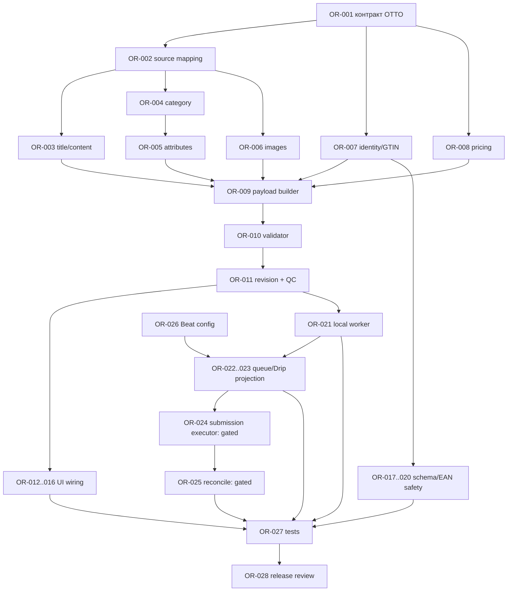

# OttoRestart — дорожная карта до завершённого workflow

> **Обновление 10.11.2026:** по уточнению пользователя цена берётся как максимум подтверждённых OTTO standardPrice и Aftercool Startpreis (для Direct OTTO — OTTO), затем JV −10 €, XL −20 €, окончание `,99`. Это решение заменяет прежние суммы и правило OTTO-only в исторических документах. Миграция 0019 применена к действующей БД OttoRestart; серверное сохранение карточки, серверная пагинация каталога и локальная проверка файла EAN реализованы. Сохранённые изменения ещё не включены в проверенную operation revision, поэтому QC для них закрыт до реализации этого шага. Product/availability publish остаётся закрытым.

**Дата:** 10.11.2026 (Asia/Qyzylorda)
**Исходная точка:** [`OTTORESTART_FULL_AUDIT.md`](OTTORESTART_FULL_AUDIT.md)
**Объём:** OR-001…OR-028; только OttoRestart. OttoFlow остаётся read-only. Фактический status update по коду от 10.11.2026 добавлен в раздел 17; миграция 0018 только подготовлена и не применена.
**Статус:** план реализации, не утверждение production publish и не разрешение на внешние записи.

## 1. Целевое состояние

Оператор должен провести один товар от импортированного source candidate до воспроизводимого, версионированного и проверяемого target payload; видеть блокировки и доказательства; подтвердить конкретную версию. В интерфейсе каждая кнопка должна использовать канонический OttoRestart API и показывать server state.

Первый завершённый результат — **local-only подготовка + QC + аудит**, без OTTO POST. Отдельная ветка публикации остаётся выключенной до подтверждения GTIN/прав OTTO и явного разрешения пользователя.

## 2. Границы реализации и non-goals

- Менять код, миграции, UI и runtime-конфигурацию только внутри `OTTO restart project/`.
- Не импортировать OttoFlow UI/store/queue; не читать или писать его бизнес-таблицы.
- Не удалять и не менять состояние старого товара.
- Не делать автоматический GTIN генератор. EAN поступает из пользовательского пула.
- Не сохранять AI key в localStorage, браузерных логах или документации. Backend config остаётся `OTTORESTART_OPENAI_API_KEY`, feature flag по умолчанию `false`. Этот code tranche не вызывает провайдера; operations UI может отправить только название после явного operator click и только при включённом feature flag.
- Не открывать `product-write`, `availability-write`, Beat или submission worker в ходе задач OR-001…OR-023.
- Не запускать live миграции, реальную БД-перепись, OTTO/Aftercool/OpenAI calls или production deployment без отдельного запроса пользователя.

## 3. Исходное состояние и принятые факты

1. Import/read путь существует и durable: `/imports/*` → `background_jobs` → разрешённый `import.process` → account-scoped OTTO/Aftercool reads → source/candidate/factory projections.
2. Preparation хранит source snapshots и цену, но пока оставляет `OTTO_TARGET_PAYLOAD_NOT_BUILT`.
3. QC, Drip eligibility и submission отказываются от readiness gaps; новая карточка не становится READY.
4. Canonical operations API уже есть, но UI/API client не подключены. Старые product write endpoints остаются отказанными 409 и не должны «оживляться» обходным путём.
5. Worker allowlist на текущем срезе допускает только `import.process`; `/queue` использует read-only projection `background_jobs`.
6. `restart_beat` не получает `OTTORESTART_MANUAL_IMPORTS_AFTER`, хотя startup guard требует его в production. Исправить конфигурацию до любого разрешённого запуска scheduler profile.
7. EAN reservation создаёт `ACTIVE ean_links`; cancel не освобождает зарезервированный EAN при наличии такой link.
8. Schema migrations 0001–0017 имеют 28 таблиц. Изменения делать только новой forward migration после структурного и data preflight.
9. Текущая цена ручного sync: для Aftercool/Afterbuy — максимум подтверждённых OTTO standardPrice и связанного Aftercool Startpreis; если доступна только одна подтверждённая цена, использовать её. Затем JV −€10 / XL −€20 и окончание `.99`. Direct OTTO использует только OTTO standardPrice. При отсутствии обеих цен целевая цена не рассчитывается.

## 4. Целевой workflow

```text
Import → source resolution → operation draft → GTIN reservation
      → content/category/attribute/image preparation
      → complete OTTO target payload → server validation
      → QC review → approval bound to payload hash + price snapshot
      ├─ MVP: read-only review, export and audit
      └─ future separately approved release: final refresh → enqueue → submit → poll → ONLINE reconciliation
```

Действие на каждой стрелке выполняется только после серверной проверки account, data scope, current version, readiness, idempotency key и права оператора.

## 5. Статусы выполнения дорожной карты

- `PARTIAL` — часть контракта существует, но сквозной сценарий не завершён.
- `IMPLEMENTED, NOT VERIFIED` — код изменён, но требуемые изолированные проверки/миграционный прогон не проводились; не считать готовым к эксплуатации.
- `PLANNED` — надо реализовать и доказать.
- `BLOCKED` — код может быть подготовлен, но активация зависит от внешнего/бизнес-решения.
- Ни одна задача этого документа не считается завершённой только по наличию файла или endpoint.

## 6. Общий контракт данных

Payload snapshot должен содержать account, source candidate/operation/revision IDs, old SKU/EAN/reference, target EAN/SKU/reference, category ID, title, category attributes, images, fulfillment, standard-price result, currency, source evidence, timestamps, readiness, policy version и content hash. Внешние поля должны соответствовать текущей официальной OTTO schema для account/category; произвольные fixture поля запрещены.

`readinessGaps=[]` допустим только если backend проверил каждый обязательный payload section по актуальной schema. `APPROVED` привязан к immutable revision ID + payload hash + price snapshot ID + QC policy version. Любое материальное изменение создаёт новую revision и сбрасывает approval.

## 7. Зависимости задач и последовательность



Параллельные ветви допустимы для schema preflight/EAN bugfix и фронтенд API scaffolding, но целевой submit path нельзя включить до завершения OR-001…OR-011, OR-017…OR-027 и отдельных business approvals.

## 8. Критический путь

`OR-001 → OR-002/003/004/005/006/007/008 → OR-009 → OR-010 → OR-011 → OR-012…016 → OR-027`.

Одновременно: `OR-017 → OR-018 → OR-019 → OR-020 → OR-027`.

Ветка реального publish продолжает критический путь только после approval: `OR-021 → OR-022 → OR-023 → OR-024 [BLOCKED approval] → OR-025 [BLOCKED approval] → OR-027 → OR-028`.

## 9. Сквозные задачи OR-001…OR-028 (поля A–M)

Значения полей в каждом пункте: **A** ID/название; **B** приоритет; **C** статус; **D** результат; **E** затронутая область; **F** контракт; **G** схема; **H** зависимости; **I** safety fence; **J** критерий готовности; **K** Level 1; **L** Level 2/3; **M** риск/откат. Пути в поле E — кандидаты, окончательно сверять по текущему checkout. Все миграции добавляются новыми файлами.

### Фаза A — payload и правила подготовки

#### OR-001 — зафиксировать target payload contract

**A** OR-001; **B** P0; **C** PARTIAL — official `POST /v5/products` requirements inspected, exact OttoRestart DTO/category mapping still not implemented; **D** Описать точный OTTO request DTO по актуальной API/category schema и account-specific required fields; **E** `backend/schemas/`, `backend/contracts/`, `docs/`; **F** DTO + schema version; **G** нет; **H** аудит официальных OTTO read/schema paths; **I** никаких POST; **J** каждый поле имеет источник/валидатор/обязательность; **K** schema fixture tests; **L** contract review на mock response; **M** неизвестные/изменившиеся поля → блокировать, оставить payload unavailable.

#### OR-002 — нормализовать source mapping

**A** OR-002; **B** P0; **C** PARTIAL; **D** Явно сопоставить OTTO и Aftercool source fields с provenance, не смешивая отсутствующее и подтверждённо пустое; **E** `backend/services/` adapters + DTO; **F** account-scoped source snapshot; **G** возможно только новая JSON/metadata колонка после доказательства необходимости; **H** OR-001; **I** только GET; **J** fixture для Aftercool, Direct OTTO, incomplete/conflicting source; **K** unit mapping tests; **L** PostgreSQL persistence/revision test; **M** конфликт двух источников → `NEEDS_REVIEW`, без выбора по порядку ответа.

#### OR-003 — title и текстовые поля

**A** OR-003; **B** P0; **C** PLANNED; **D** Построить title/описание из проверяемых данных; AI — optional suggestion, не доверенная истина; **E** preparation/content service, schemas; **F** bounded fields + provenance; **G** revision JSON; **H** OR-001, OR-002; **I** AI выключен по умолчанию; **J** missing title/length/unsupported claims блокируют payload; **K** deterministic fixtures; **L** no-network adapter tests; **M** hallucinated or incomplete text → manual input required.

#### OR-004 — category resolution

**A** OR-004; **B** P0; **C** PARTIAL; **D** Сопоставить source category с точным OTTO category ID и валидировать, что он активен для account; **E** category adapter/repository + preparation; **F** ID + schema version + source evidence; **G** cache table только если требуется; **H** OR-001/002; **I** не полагаться на demo regex; **J** category unknown/ambiguous не позволяет `READY`; **K** fixture mapping tests; **L** stale-schema/DB test; **M** schema unavailable → `CATEGORY_SCHEMA_NOT_AVAILABLE`, fail closed.

#### OR-005 — attributes/defaults

**A** OR-005; **B** P0; **C** PARTIAL; **D** Извлечь требуемые поля, сохранить значения и origin, проверить типы/единицы/enum; **E** `constant_attributes.py`, category schema, preparation/QC; **F** typed attributes keyed by OTTO schema; **G** revision content; **H** OR-001/002/004; **I** никаких демонстрационных hardcodes; **J** обязательные пустые/невалидные значения дают конкретный blocker; **K** rule/unit tests; **L** revision persistence tests; **M** legal/brand default не подтверждён → не включать автоматически.

#### OR-006 — изображения

**A** OR-006; **B** P0; **C** PLANNED; **D** Подтвердить URL/ordering/source rights, тип и доступность изображений; **E** source adapter + payload builder; **F** bounded list of verified image refs; **G** при необходимости новая image snapshot metadata; **H** OR-001/002; **I** никаких внешних upload/write в MVP; **J** invalid/absent required image blocks readiness; **K** URL/schema fixtures; **L** no-egress validation; **M** временная/недоступная ссылка → retry/readiness gap, не выдумывать image.

#### OR-007 — identity и GTIN policy gate

**A** OR-007; **B** P0; **C** PARTIAL; **D** Подтвердить target EAN/SKU/productReference, владение GTIN и разрешённый товарный сценарий; **E** `ean_pool_service.py`, GTIN evidence, preparation/QC; **F** immutable identity mode + evidence IDs; **G** существующие новые таблицы; **H** OR-001; **I** загрузка EAN ≠ право на использование; **J** отсутствие/конфликт evidence блокирует approval; **K** ownership/account conflict tests; **L** concurrency tests; **M** правило OTTO/GS1 не подтверждено → publish feature остаётся disabled.

#### OR-008 — единая price snapshot policy

**A** OR-008; **B** P0; **C** PARTIAL; **D** Закрепить актуальное правило max-source − JV €10/XL €20, rounded-to-99, корректную валюту и provenance; **E** pricing service, preparation, QC, submit freshness; **F** integer cents/Decimal snapshot; **G** revision price snapshot; **H** OR-001/002; **I** no salePrice; отсутствие доказанной цены блокирует; **J** одинаковый расчёт во всех stages; **K** edge-case pricing tests; **L** repeated sync/price-change tests; **M** изменившаяся цена → invalidation/reapproval, no stale payload.

#### OR-009 — собрать полный immutable payload

**A** OR-009; **B** P0; **C** PLANNED — HTTP preparation is now closed before reads/EAN reservation until this builder exists; **D** Соединить title/category/attributes/images/identity/price/fulfillment в OTTO DTO; **E** preparation service и revision creation; **F** `ottoProductPayload` + deterministic hash; **G** использовать operation revisions; **H** OR-003…008; **I** запрещено заглушать незаполненные поля пустым `{}` и снимать gaps вручную; **J** payload воспроизводится из сохранённой revision; **K** deterministic serialization tests; **L** DB hash roundtrip; **M** любое несоответствие сохраняет blocker и запрещает submit.

#### OR-010 — validator и readiness gaps

**A** OR-010; **B** P0; **C** PARTIAL; **D** Заменить единственный постоянный gap конкретной проверкой DTO/schema; **E** QC/preparation validators; **F** стабильные machine-readable issue codes; **G** QC result JSON; **H** OR-009; **I** frontend не может передать `readinessGaps=[]` как authority; **J** валидный payload единственный путь к `READY_FOR_QC`; **K** issue matrix tests; **L** API auth/version tests; **M** unknown validator error → fail closed.

#### OR-011 — immutable revisions, approval и QC

**A** OR-011; **B** P0; **C** PARTIAL; **D** Связать approval с revision ID, hash, price snapshot и policy version; **E** operation/revision/QC services; **F** optimistic version + idempotency; **G** текущие `operation_revisions`, `qc_results`, при нужде новая миграция; **H** OR-009/010; **I** edit после approval сбрасывает approval; **J** QC outcome объясняет все ошибки и review reasons; **K** version/state machine tests; **L** PostgreSQL concurrent update test; **M** rollback к предыдущей immutable revision, но не переписывать её.

### Фаза B — связать реальный backend с интерфейсом

#### OR-012 — typed client canonical operations

**A** OR-012; **B** P0; **C** PARTIAL — create/prepare/QC/AI status DTO/client methods added; **D** Add remaining operation methods and verify contracts; **E** `features/api/client.ts`, `types.ts`; **F** match FastAPI response and auth headers; **G** none; **H** OR-011; **I** account required, legacy 409 endpoints not reused; **J** each verb/problem response tested; **K** Node client tests; **L** BFF contract tests; **M** DTO mismatch blocks action.

#### OR-013 — экран создания операции и EAN allocation

**A** OR-013; **B** P0; **C** PARTIAL — candidate screen can create an explicitly confirmed local DRAFT; **D** Add safe EAN allocation only after verified payload/identity policy; **E** production operations workspace/client; **F** canonical `/operations`; **G** existing tables; **H** OR-007/012/018; **I** DRAFT does not reserve EAN; **J** account/candidate/version shown; **K** UI state tests; **L** allocation concurrency tests; **M** partial errors preserve row results.

#### OR-014 — подготовка и QC UI

**A** OR-014; **B** P0; **C** PARTIAL — Review/QC routes show production candidates; prepare/QC/approval actions are deliberately absent; **D** Add workflow after target payload contract and safe source preflight are established; **E** `/review`, `/quality-control`, batch details; **F** revision IDs/current versions only; **G** none beyond OR-011; **H** OR-010/011/012; **I** approval is not enqueue; publish controls stay hidden/disabled; **J** loading/empty/error/permission/stale states; **K** UI/API mocks; **L** authenticated BFF integration; **M** API unavailable → retryable error, no optimistic READY.

#### OR-015 — заменить устаревшие product mutations

**A** OR-015; **B** P0; **C** PARTIAL — legacy mutations hidden/disabled outside demo, source sync remains available; **D** Route future edits through revision API only after content mapping is defined; **E** `product-drawer.tsx`, catalog wiring, API client; **F** idempotent revision + expectedVersion; **G** operation revision; **H** OR-012/014; **I** do not restore shortcuts that fabricate a revision; **J** UI save reflects persisted revision; **K** callback/API tests; **L** version conflict scenario; **M** mismatch must not overwrite latest version.

#### OR-016 — сделать AI status и ключи честными/серверными

**A** OR-016; **B** P1; **C** PARTIAL — Settings reads `/ai/status`; authenticated title-only suggestion is available only after explicit click and when the feature flag is enabled; **D** Keep secret server-side and preserve AI disabled by default; **E** Settings/BFF/AI adapter/operations UI; **F** responses never expose key and send only source title; **G** no client secret fields; **H** OR-012 auth + CSRF + account write permission; **I** status/load never calls GPT; only explicit title-suggestion action can egress; **J** verify no request on page load/status and title-only request on click using a mocked transport; **K** mocked config and output-validation checks; **L** never invoke the configured key during implementation checks; **M** leave AI unavailable if config unclear.

### Фаза C — данные, ограничения и EAN lifecycle

#### OR-017 — repair scoped uniqueness / factory identity

**A** OR-017; **B** P0; **C** PARTIAL — factory PK already scope-aware since migration 0010; migration 0018 adjusts source identities; **D** Complete the remaining scope/index review; **E** OttoRestart migrations/repositories; **F** preserve account and scope on identity operations; **G** forward-only revision 0018 applied to the selected active DB after preflight; schema/checksum check passed, disposable upgrade/downgrade and concurrency tests remain; **H** inventory PK/unique/FK; **I** no rewrite of applied migrations or unverified backfill; **J** same source identity may exist in separate scopes where intended; **K** migration lint/schema checks; **L** empty/prior-head upgrade and duplicate checks; **M** guarded rollback; no destructive downgrade.

#### OR-018 — исправить import eligibility для unverified scope

**A** OR-018; **B** P0; **C** IMPLEMENTED, NOT VERIFIED — legacy scope imports are stored `UNVERIFIED`; **D** Preserve fail-closed eligibility semantics; **E** `ean_pool_service.py`; **F** unverified ownership cannot become production eligible; **G** no migration expected; **H** OR-017; **I** only explicit actor/evidence can change eligibility; **J** legacy import does not fabricate verification; **K** unit constraint cases; **L** PostgreSQL check test; **M** no bulk update without data review.

#### OR-019 — исправить cancel/release EAN atomicity

**A** OR-019; **B** P0; **C** IMPLEMENTED, NOT VERIFIED — confirmed never-submitted cancellation deactivates lineage and releases the pool record; cancellation also refuses to finish if operation EAN is missing while active lineage/reservation still exists; **D** Keep uncertain/submitted EAN reserved/quarantined; **E** `operation_service.py`, EAN service; **F** retain link history with terminal status; **G** migration 0018 permits a new active link after deactivation; **H** OR-018 and state definitions; **I** row locks + operation/version + ownership; **J** transactionally consistent cancellation; **K** state matrix checks; **L** concurrent PostgreSQL cancel/reserve check; **M** uncertain submit outcome never returns EAN to AVAILABLE.

#### OR-020 — preflight и reconciler для данных scopes

**A** OR-020; **B** P1; **C** PARTIAL — read-only preflight script authored, not run; **D** Count 0018 index conflicts, orphan references, inconsistent EAN eligibility/reservation states, and duplicate operation identities; **E** `backend/scripts/restart_scope_preflight.py`; **F** JSON aggregates keyed by account/scope set, no identifiers or secrets; **G** PostgreSQL repeatable-read/read-only transaction; **H** OR-017/018/019; **I** accepts only explicit `OTTORESTART_PREFLIGHT_DATABASE_URL`, no fallback to app/migration URL, no apply path; **J** deterministic aggregate checks on the selected snapshot; **K** static Python syntax only so far; **L** disposable schema-0017 and post-0018 snapshot runs remain outstanding; **M** do not point at production/user data without separate explicit approval.

### Фаза D — очередь и background execution

#### OR-021 — local-only prepare/QC executors

**A** OR-021; **B** P1; **C** PLANNED; **D** Добавить durable handlers для локальной подготовки/QC только после успешного API path; **E** `backend/jobs/`, executors, retry patterns; **F** job type + idempotent operation ID/version; **G** использовать current outbox/attempt tables; **H** OR-011/019; **I** allowlist содержит только local tasks; никакого OTTO POST; **J** retry не удваивает revision/reservation; **K** fake-engine/executor tests; **L** Redis/PG duplicate delivery tests; **M** rollback — выключить allowlist и оставить jobs pending.

#### OR-022 — production queue projection API

**A** OR-022; **B** P1; **C** PARTIAL — account-scoped read-only `background_jobs` projection and production UI panel added; **D** Keep projection limited to safe metadata; include submission attempts only if they exist; **E** `backend/app.py`, `services/queue_projection_service.py`, BFF client, queue UI; **F** pagination, status counts and timestamps; **G** existing jobs table; **H** independent from job execution; **I** GET only, never trigger work from queue view; **J** UI distinguishes actual empty/error/status; **K** projection mapping check; **L** DB fixture and pagination check; **M** if data cannot be read, show error instead of empty list.

#### OR-023 — Drip schedule orchestration и stop/pause semantics

**A** OR-023; **B** P1; **C** PARTIAL; **D** Связать schedule record → due release → local queued state с idempotency, timezone и account; **E** drip/schedule services and endpoints; **F** immutable item/revision refs; **G** schedule tables уже есть, проверить migration 0011+; **H** OR-021/022; **I** `publishAllowed=false` пока no approval; **J** pause prevents future jobs, не отменяя неизвестную внешнюю операцию; **K** schedule unit/DST tests; **L** Beat/PG schedule replay tests; **M** duplicate tick harmless, schedule disable rollback.

#### OR-024 — создать submit executor, но оставить выключенным

**A** OR-024; **B** P0 для safety / P2 для реализации; **C** BLOCKED; **D** В будущем отправлять только неизменяемый, approved payload после повторных price/schema/GTIN checks; **E** OttoRestart-only submission adapter/executor; **F** idempotency key + request fingerprint + response/task href; **G** existing attempts, новые поля только обоснованной миграцией; **H** OR-001…011, OR-021…023, written business approval; **I** product-write flag false; код не активировать; один POST без blind retry; **J** mock request proves exact payload/hash/price gate; **K** fake transport only; **L** sandbox only after explicit authorization; **M** ambiguous timeout → reconcile before retry, no duplicate POST.

#### OR-025 — независимая processing/ONLINE reconciliation

**A** OR-025; **B** P1; **C** BLOCKED; **D** Проверять task processing, account/SKU, `activeStatus`, `marketplaceStatus` и target price; **E** status pollers/worker/UI; **F** explicit evidence timestamp and source response; **G** existing poll tables or additive migration if necessary; **H** OR-024 + OTTO confirmation contract; **I** GET only and false until all criteria pass; **J** 202/active alone не значит ONLINE; **K** response classifier tests; **L** mock repeated polling/DB tests; **M** status mismatch → `RECONCILIATION_REQUIRED`, do not retry write.

#### OR-026 — исправить Beat environment guard

**A** OR-026; **B** P1; **C** IMPLEMENTED, NOT VERIFIED — Compose passes the required cutoff to Beat; Beat remains stopped; **D** Keep scheduler profile default off; **E** OttoRestart `docker-compose.yml`, runbook; **F** same explicit cutoff for worker/dispatcher/Beat when enabled; **G** none; **H** OR-023; **I** no scheduler activation in this tranche; **J** validate config without starting Beat; **K** environment parsing; **L** Compose config; **M** invalid config must fail before dispatch.

### Фаза E — доказательство и выпуск

#### OR-027 — полный verification matrix

**A** OR-027; **B** P0; **C** PLANNED; **D** Добавить/пройти tests по payload, UI/API, migrations, scope, concurrency, retry, account and fail-closed states; **E** OttoRestart test suites/CI instructions; **F** контрактные fixtures; **G** disposable PostgreSQL migration from empty DB + supported prior head; **H** OR-001…026; **I** mock/external disabled; **J** test inventory maps each acceptance to evidence; **K** unit + TypeScript/Node; **L** PostgreSQL/Redis in isolated network; **M** не объявлять release при skipped migration/integration gate.

#### OR-028 — release review, runbook и отдельный gate

**A** OR-028; **B** P0; **C** PLANNED; **D** Сформировать operator rollout, rollback, monitoring, credentials handling, data backup and approval sheet; **E** `docs/OPS_RUNBOOK.md`, `docs/RELEASE_CHECKLIST.md`, audit docs; **F** версия payload/schema/policy + pilot scope; **G** подтверждённый migration plan; **H** OR-027; **I** no production write unless separate written user approval and business GTIN/OTTO gate; **J** reviewer can execute rollback and prove ONLINE criteria; **K** docs link audit evidence; **L** isolated deployment rehearsal, then separately approved pilot; **M** stop switch disables intake/write, never claims rollback of already accepted OTTO jobs.

## 10. API контракты, которые нужно закрыть

| API | Нужное поведение | Gate |
|---|---|---|
| `POST /operations` | Создать draft конкретного account/candidate с idempotency/version | Local write permission |
| `POST /operations/{id}/prepare` | Сформировать новую immutable revision и source snapshots | Сейчас fail-closed `409 OTTO_TARGET_PAYLOAD_NOT_BUILT` до source reads и EAN reservation; открыть только после complete mapping |
| `POST /operations/{id}/manual-revision` | Применить явные patch поля к новой revision | Allowlist полей; expected version; approval reset |
| `POST /operations/{id}/qc` | Вернуть machine-readable issues + review decision | Readiness gaps должны быть пусты |
| `POST /operations/{id}/cancel` | Atomic local cancellation + безопасный release/quarantine | `NEVER_SUBMITTED` для release |
| `GET /queue` | Реальные persisted jobs/attempts по account, pagination | Read-only |
| `POST /batches/{id}/enqueue` | У будущей версии — только approved immutable revision | Не включать до отдельного approval |

Legacy `/products/assign-ean`, `/products/generate-titles`, `PATCH /products/{id}` должны оставаться fail-closed либо отвечать с явным migration hint. Их нельзя использовать как альтернативный API для обхода operation model.

## 11. План миграций

1. Сначала составить preflight по фактической схеме и данным, в частности original PK/unique constraints без `data_scope`, orphan refs, EAN status/provenance и scoped duplicates.
2. Для каждому constraint определить upgrade и безопасный downgrade; существующие 0001–0017 не редактировать.
3. Добавить только новые forward migrations. Не удалять старые lineage/event rows и не снимать ограничения ради успешного deploy.
4. Прогнать migration chain на пустой PostgreSQL и на синтетической копии версии 0017; проверить concurrency/foreign keys.
5. Отдельная операторская approval нужна для применения к окружению с пользовательскими данными. Этот roadmap не включает такое применение.

## 12. Реализация UI по экранам

1. **Product catalog/drawer:** заменить фальшивые AI handlers и legacy writes на синхронизацию источника, operation revision, status/error from server. Сохранить account boundary.
2. **Review/QC:** production client, issues с источником, version snapshot, approval только конкретной revision.
3. **EAN pool:** реальная production API, внятно разделённые `AVAILABLE/RESERVED/USED/QUARANTINED`, provenance и подтверждённое eligibility; demo banner в demo mode.
4. **Batches:** отделить настоящие import/discovery runs от synthetic demo batches; не подмешивать session fixtures.
5. **Queue/Drip:** API projection из persisted jobs, попыток и task status; пусто только при реальном total=0.
6. **Settings:** получать backend AI feature status; показывать локально конфигурируемый/недоступный статус, не поле для хранения секрета в browser.
7. На каждом экране предусмотреть loading, empty, error, stale version, permission denied, retryable external read и reason code states.

## 13. Уровни проверок

### Level 1 — локальные и mock

- Unit: identity/pricing/category/attribute/image mapping, validator, state transitions, cancellation decisions.
- Node: API client, auth/CSRF headers, `409`/`422`/version conflict rendering, loading/error state.
- Доказать, что тесты не обращаются к live OTTO/Aftercool/OpenAI; GPT key не читается.

### Level 2 — disposable PostgreSQL/Redis

- Пройти миграции 0001…latest на пустой DB и upgrade synthetic 0017 dataset.
- Проверить FK/PK/unique, cross-scope same factory IDs, account isolation, EAN reservation race, cancellation atomicity, concurrent revisions, idempotent duplicate delivery.
- Внутренняя Docker network без egress; база/контейнеры тестовые и удаляются.

### Level 3 — отдельный изолированный runtime

- Build/start OttoRestart только на отдельной схеме/сервисах; внешние writes отключены.
- Проверить авторизацию, BFF, health, UI→API→DB и worker gate на mock/read-only transport.
- Реальные OTTO/Aftercool GETs требуют отдельного scope и explicit user request; ни одной write операции по данному плану.
- Production pilot допускается только после OR-028 review, GTIN/OTTO business confirmation и отдельного письменного разрешения.

## 14. Граф готовности и release criteria

Release candidate для **local-only preparation/QC** готов только если:

- OR-001…OR-020 закрыты, API и UI работают на одной канонической state machine;
- operation payload создаётся с `readinessGaps=[]` только на валидной OTTO schema;
- QC approval hash/version/price snapshot совпадают с тем, что показывает UI;
- EAN scope/eligibility/cancel исправлены и доказаны PostgreSQL concurrency tests;
- реальная очередь не показывает hardcoded пустой список;
- worker запускает только явно разрешённые local-only jobs; Beat config проверен, но default off;
- OR-027 пройден и verification report хранит результаты.

**Production publication остаётся отдельным релизом:** OR-024 и OR-025 заблокированы до отдельного разрешения. Успешное локальное QC не является доказательством разрешённого GTIN, успешного OTTO POST или ONLINE статуса.

## 15. Откат и аварийная остановка

- Кодовая rollback: отключить OttoRestart local-write/worker profiles, оставить API read-only; не менять OttoFlow.
- Очередь: остановить intake/dispatcher; уже принятый брокером job определить по persisted id и завершить/зафенсить; не удалять историю.
- DB: не запускать destructive downgrade на пользовательской схеме; использовать заранее проверенный backup/restore plan и forward correction.
- Внешний POST при будущем разрешении: после неизвестного исхода сначала reconcile по OTTO, затем операторское решение; никаких blind retries.
- EAN в неизвестном исходе остаётся зарезервированным/quarantined до audit review.

## 16. Итоговый чек-лист по этапам

- [ ] P0: подтвердить payload/category/identity/price contract и закрыть readiness blocker.
- [ ] P0: завершить canonical operation UI; сейчас доступно только создание локального DRAFT, prepare/QC/revision остаются закрыты.
- [ ] P0: провести disposable PostgreSQL upgrade/downgrade/concurrency checks для migration 0018; на выбранную активную БД migration уже применена после отдельной операторской процедуры и read-only preflight, head/checksum проверены; код eligibility/cancel всё ещё требует интеграционных проверок.
- [ ] P1: добавить только local preparation/QC jobs и реальную queue projection.
- [ ] [x] Передать Beat обязательный cutoff в Compose; сам Beat оставить выключенным.
- [ ] P0: провести Levels 1–2 на isolated test infrastructure и сохранить доказательства.
- [ ] P0: обновить Runbook, release checklist и архитектурный ценовой текст.
- [ ] BLOCKED: отдельно получить разрешение на production product/availability writes и подтвердить правила OTTO/GS1.
- [ ] BLOCKED: только после этого рассматривать ограниченный production pilot и подтверждение ONLINE.

Документальные файлы не открывают флаги и не меняют приложение.

## 17. Кодовый status update — 10.11.2026

После первоначального аудита реализован ограниченный fail-closed tranche внутри `OTTO restart project/`; это не deploy/release и не подтверждение миграции на рабочей БД.

| Область | Кодовый статус | Остаток / доказательства |
|---|---|---|
| Production frontend routes | API-backed batches, batch details, EAN pool, history подключены; review/QC routes показывают candidates и дают только явное локальное создание DRAFT | Нет workflow подготовки/QC/approval. TypeScript статически прошёл; suites не запускались |
| Legacy product mutations | Скрыты/disabled вне demo; обработчики вне demo закрываются без старых write endpoints | Canonical revision API пока не используется для редактирования карточки |
| AI | Settings reads `/ai/status`; production operations offers a title-only suggestion only when `available=true` and after operator click | Result is an unsaved draft for manual review; no GPT request was made during implementation; operator reports the key is configured, not independently verified |
| Source sync | Explicit account-scoped sync callback передан в production catalog/drawer | Это source reads + локальное сохранение snapshot/revision, не target payload и не listing write |
| EAN eligibility/cancel | Legacy scope получает `UNVERIFIED`; never-submitted cancel deactivates lineage and safely releases reservation | Python syntax compiled; database behavior not integration-tested |
| Scoped indexes | Migration 0018 scopes `source_products` identity and `otto_library.old_ean`; preserves account-wide uniqueness for target EAN; deactivated `ean_links` no longer block reallocation | Applied to the selected active DB after preflight; head/checksum pass; disposable upgrade/downgrade and concurrency evidence remain |
| Worker/Beat | Import-only allowlist unchanged; required cutoff now passed to Beat service definition | Beat not started; no other job executor enabled |
| Durable queue | Read-only account-scoped jobs projection and UI panel added | Database integration not exercised; non-import job types remain unexecuted |
| Target payload/QC | Remain blocked/incomplete | `OTTO_TARGET_PAYLOAD_NOT_BUILT`, no submission executor |

No GPT, OTTO, or Aftercool request was made in this tranche. No DB, migration, container, Beat, test suite, or production operation was run. Do not describe this as a completed OttoRestart production workflow.

## 18. Fail-closed preparation gate — 10.11.2026

- The production HTTP route `POST /operations/{id}/prepare` now checks `TARGET_PAYLOAD_BUILDER_READY=False` after account/write authorization and idempotency-key format validation, but before DB lookup, OTTO/Aftercool adapters, EAN reservation, or persisted changes. It returns `409 OTTO_TARGET_PAYLOAD_NOT_BUILT` with `sourceReadsPerformed=false` and `eanReserved=false`.
- This closes the route's previous side-effect path while the implementation always generated a readiness gap. The pure internal `prepare_operation_revision()` remains an unconnected service implementation and must not be wired to another route/job until the payload contract is complete.
- The official OTTO `POST /v5/products` contract lists `productDescription`, `mediaAssets`, `pricing`, and `compliance` as required. OTTO Best Practices additionally call out required identity/category/brand fields, Legal attributes, category-driven formats, and image requirements. The current OttoRestart adapters/fixtures do not establish a full validated mapping for these fields; OR-001 and OR-009 therefore remain open. References: [Products API](https://api.otto.market/docs/api-docs/), [Best Practices](https://api.otto.market/docs/about-the-api/best-practices/).
- No account API request was made; only official documentation pages were consulted. No GPT request or key inspection, DB access, migration, container, Beat, publish, or test suite was run. Python syntax compilation passed for the changed backend modules; earlier TypeScript check remains the frontend evidence. Host Docker does not provide the Compose subcommand, so the compose config check could not be performed.
- Keep OR-024/025 blocked and the worker allowlist import-only. The static gate can be removed only as part of OR-009 after schema fixtures and no-egress validation exist; never by environment override.

## 19. Scope migration preflight tooling — 10.11.2026

- Added `backend/scripts/restart_scope_preflight.py` for two explicit checkpoints: schema 0017 before migration 0018 and schema 0018 before a guarded rollback. It reports migration index conflicts, rollback-only uniqueness conflicts, duplicate production operation identities, account/scope reference mismatches, and inconsistent EAN verification/reservation state.
- The script uses only `OTTORESTART_PREFLIGHT_DATABASE_URL`, opens a repeatable-read/read-only transaction, emits aggregate JSON without EANs, product IDs, connection strings, or credentials, and has no write/apply mode. It does not auto-load `.env` or fall back to app/migration database variables.
- Static Python syntax compilation passed. The script was not connected to any database, so OR-020 remains partial until its report is reviewed on a disposable 0017 snapshot and a disposable post-0018 snapshot. No tests, migration, container, or external API request was run; `GPT_API_KEY` was not inspected or used.
